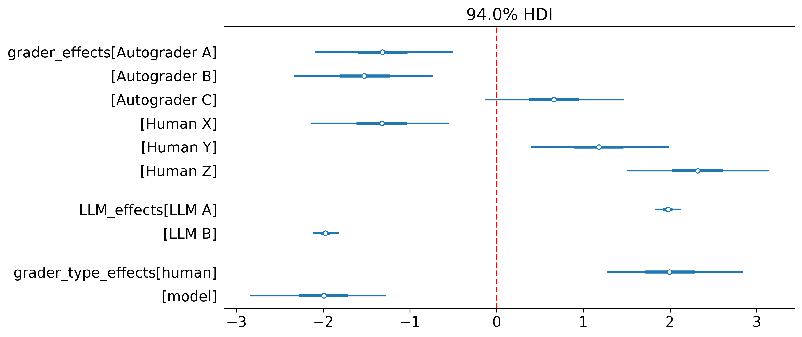

Communicators help you _communicate_ your findings. They cover both tables and plots. Again there are a set of default communicators built into hibayes which you can select from.


## Built-in Communicators

| Communicator | Purpose | Key Parameters |
|--------------|---------|----------------|
| `forest_plot` | Forest plot of parameter estimates with credible intervals | `vars=None`, `vertical_line=None`, `best_model=True`, `transform=False` |
| `trace_plot` | MCMC trace plots to assess convergence and mixing | `vars=None`, `best_model=True`, `transform=False` |
| `pair_plot` | Pairwise KDE plots showing parameter correlations | `vars=None`, `best_model=True` |
| `model_comparison_plot` | Compares models using information criteria (LOO/WAIC) | Requires ≥2 fitted models |
| `summary_table` | Statistical summary table of posterior parameters | `vars=None`, `best_model=True`, `round_to=2` |
| `binomial_estimands_table` | Explicit probability-scale summaries for the two grouped binomial models | `best_model=False`, `credible_interval=0.95` |
| `comparison_summary` | For `accuracy_comparison` fits: accuracies, accuracy difference with credible interval, P(compared model better) and P(practically equivalent), per fit, group and compared model | `credible_mass=0.95`, `practical_difference=0.01`, `best_model=False` |

## Binomial estimands

```yaml
communicate:
  communicators:
    - binomial_estimands_table: {best_model: false, credible_interval: 0.95}
```

This adds a `model_<name>_binomial_estimands` table with posterior mean,
standard deviation, and equal-tailed interval bounds (`ci_lower`, `ci_upper`).
Rows distinguish median group probability, equal-weight evaluated-group
average, trial-weighted evaluated-group average, and integrated population
average; see [their definitions and assumptions](models.qmd#choosing-a-grouped-binomial-estimand).
All values are already probabilities. No link function is applied.

It supports `simplified_group_binomial_exponential` and
`two_level_group_binomial`, including saved fits that retain `group_index`
and `n_total` features. Groups with no positive trial counts are excluded
from evaluated averages; repeated rows contribute their combined trial counts.
The communicator includes all fitted supported models by default so differences
between pooling assumptions remain visible. Other models in a mixed config
are skipped with a warning. The population integral uses adaptive numerical
integration, in bounded batches, without adding Monte Carlo group noise.

For custom probability statements or plots, access the per-draw quantities:

```python
from hibayes.communicate import group_binomial_estimands

draws = group_binomial_estimands(model_analysis_state)
probability_above_threshold = (draws["evaluated_group_mean_probability"] > 0.8).mean()
```

Rows are ordered by chain, then draw. These are summaries of the fitted
posterior, not diagnostics or permission to ignore prior sensitivity. Check
convergence and predictive fit before using them for a threshold claim.


## What makes up a communicator?
Communicators simply take in an [AnalysisState](analysis-state.qmd) and add a plot or a table. Here we see the implementation for a forest_plot, noting that you can define your own communicators using the same methodology

```python
@communicate # <1>
def forest_plot(
    vars: list[str] | None = None,
    vertical_line: float | None = None,
    best_model: bool = True,
    figsize: tuple[int, int] = (10, 5),
    transform: bool = False,
    *args,
    **kwargs, # <2>
):
    def communicate(
        state: AnalysisState,
        display: ModellingDisplay | None = None,
    ) -> Tuple[AnalysisState, CommunicateResult]:
        """
        Communicate the results of a model analysis.
        """
        nonlocal vars
        if best_model: # <3>
            best_model_analysis = state.get_best_model()
            if best_model_analysis is None:
                raise ValueError("No best model found.")
            models_to_run = [best_model_analysis]
        else:
            models_to_run = state.models

        for model_analysis in models_to_run:
            if model_analysis.is_fitted:
                vars, dropped = (
                    drop_not_present_vars(vars, model_analysis.inference_data)
                    if vars
                    else (None, None)
                )
                if dropped and display:
                    display.logger.warning(
                        f"Variables {dropped} were not found in the model {model_analysis.model_name} inference data."
                    )
                if vars is None:
                    vars = model_analysis.model_config.get_plot_params()

                ax = az.plot_forest(
                    model_analysis.inference_data,
                    var_names=vars,
                    figsize=figsize,
                    transform=model_analysis.link_function if transform else None,
                    *args,
                    **kwargs,
                )

                if vertical_line is not None:
                    ax[0].axvline(
                        x=vertical_line,
                        color="red",
                        linestyle="--",
                    )
                fig = plt.gcf()

                state.add_plot( # <4>
                    plot=fig,
                    plot_name=f"model_{model_analysis.model_name}_{'-'.join(vars) if vars else ''}_forest",
                )
        return state, "pass"

    return communicate
```
1. here we register the communicator and enforce an agreed upon interface.
2. very useful to have kwargs here, as the user often have their own plotting args they want passed on to the plt functions.
3. if you only want to create plots for the model which fitted the model best according the information criterion specified. Otherwise plot for every model.
4. add the plot to the analysis state. Check output dir for plots

Here is an example forest plot with default configs from [LLM-as-a-judge example](examples/llm-as-a-judge.qmd)


