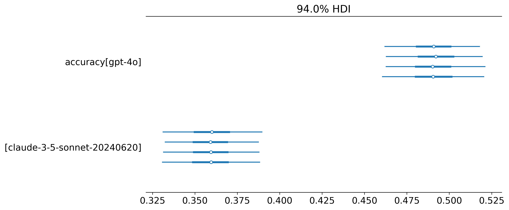

## Overview

The most common evaluation question is also the simplest: *is model A better than model B on this benchmark, and by how much?* This example answers it in three steps, adding one piece of structure at a time. It is located in `examples/comparing-two-models/` and uses the gpt-4o and Claude 3.5 Sonnet Inspect logs shipped with the [HiBayES use cases](hibayes-usecases.qmd) (boolq, RACE-H, MBPP and DS-1000).

| Step | Question | What it adds |
|---|---|---|
| 1. `step1-unpaired` | What are the two models' accuracies on DS-1000, and how far apart are they? | Two accuracies, nothing else |
| 2. `step2-paired` | Same question, using the fact that both models answered the same items | A difficulty offset per item, shared by both models |
| 3. `step3-all-benchmarks` | Where does each model win, across four benchmarks? | A separate difference per benchmark, and repeated runs (epochs) handled |

Every step reports the same headline quantities on the accuracy scale: each model's accuracy, the **accuracy difference** with a 95% credible interval, **P(Claude better)**, and the probability that the difference is under one percentage point (practically equivalent). These come from the `comparison_summary` communicator, so the steps can be read side by side.

All three steps use one built-in model, `accuracy_comparison`, with different switches: step 1 turns the item term off, step 2 turns it on, and step 3 adds a group per benchmark. The fit check is the built-in `agreement_check` checker. The example directory adds three plots of its own (`custom_communicators.py`, registered through each config's `communicate.path`), and the end of this page shows how you would write the model yourself.

## Running it

From any step directory:

```bash
uv run hibayes-full --config files/config.yaml --out .output
```

or, with [DVC](https://dvc.org), `uv run dvc repro`. The results table is `.output/communicate/comparison_summary.csv`. Steps 1 and 2 take a minute or two on a laptop CPU; step 3 (about 18,000 answers) takes a few minutes and writes about 750 MB of posterior samples.

## Step 1: two accuracies

The simplest defensible model: every answer is an independent coin flip whose probability depends only on which model gave it.

```yaml
data_process:
  processors:
    - groupby: {groupby_columns: [model]}             # <1>
    - extract_features:
        categorical_features: [model]
        continuous_features: [n_total]
        reference_categories: {model: gpt-4o}          # <2>
    - extract_observed_feature: {feature_name: n_correct}

model:
  models:
    - name: accuracy_comparison
      config: {tag: unpaired, item_column: null, fit: {seed: 0}}   # <3>
```
1. Aggregate to one row per model: `n_correct` out of `n_total`. With `n_total` present the model uses a binomial likelihood.
2. gpt-4o becomes the reference (the first category), so `difference` is Claude minus gpt-4o.
3. `item_column: null` switches off the per-item term, leaving two accuracies.

The model has two parameters on the log-odds scale: `baseline` (gpt-4o) and `difference` (what Claude adds). Their priors were chosen by what they imply about accuracy. `Normal(0, 1.5)` on `baseline` is roughly uniform on accuracy, and `Normal(0, 1)` on `difference` puts 95% of its weight on gaps within ±36 percentage points. That allows any realistic gap between two frontier models while ruling out absurd ones such as 10% vs 90%:

![What each prior implies on the accuracy scale, simulated from the priors alone before the model sees any data. Left: the baseline prior spreads gpt-4o's accuracy evenly from 0 to 1, with no pile-up at 0% or 100% (the sign of a too-wide prior on the log-odds scale). Right: combined with the baseline, the difference prior centres the gap on zero and keeps it within about ±0.36. Made by the example's `prior_plot` communicator, which runs the configured model with no data, so it reflects whatever priors the config sets.](../figs/comparing-two-models/priors.png)

**Result.** gpt-4o 49.1%, Claude 35.9%: a difference of **−13.2 points (95% CI −17.4 to −8.9)**, P(Claude better) < 0.001.

P(Claude better) is the share of the 8,000 posterior samples in which Claude comes out ahead. None of them do: the gap is about six standard errors (≈ 2.2 points each) from zero. The true probability is tiny but not zero, and 8,000 samples can't resolve anything much smaller than 1 in 1,000, so `comparison_summary` reports it as "< 0.001" rather than 0.



`groupby` leaves two rows, one per model, but each row is a binomial count ("491 correct out of 1000"). That carries the same information as the 1000 individual answers, so the sample size is still 1000 answers per model. Step 2 confirms this: fitting the same model to the 2000 ungrouped answers gives the same result.

There are no `loo`/`waic` checks in this step. Leave-one-out removes one *row* at a time, and with two rows that would mean predicting all of one model's answers from the other's. That isn't a meaningful check, so it's left to step 2.

## Step 2: pair the answers

Both models answered the *same* 1000 items, and most items are answered the same way by both:

|  | gpt-4o wrong | gpt-4o right |
|---|---|---|
| **Claude wrong** | 424 | 217 |
| **Claude right** | 85 | 274 |

The 698 items where the models agree say a lot about the items and almost nothing about which model is better. The 302 disagreements carry the comparison. The same holds on every benchmark in the example, and on the easier ones agreement dominates even more:


Step 1 can't see this, because it treats the 2000 answers as independent. Step 2 keeps one row per answer and gives each item a difficulty offset shared by both models:

$$\text{logit}\,P(\text{correct}) = \text{baseline} + \text{difference}\times\text{is Claude} + \text{item offset}, \qquad \text{item offset} \sim \text{Normal}(0, \sigma_\text{item})$$

```yaml
data_process:
  processors:
    - map_columns: {column_mapping: {task: item}}      # <1>
    - extract_features:
        categorical_features: [model, item]
        reference_categories: {model: gpt-4o}
    - extract_observed_feature: {feature_name: score}  # <2>

model:
  models:
    - name: accuracy_comparison                         # <3>
      config: {tag: unpaired, item_column: null, fit: {seed: 0}}
    - name: accuracy_comparison                         # <4>
      config: {tag: paired, fit: {seed: 0}}
```
1. `base_extractor` stores the Inspect sample id as `task`. Here it identifies the item.
2. No `groupby`: one 0/1 row per answer, so the model can see which answers belong to the same item.
3. The step 1 model again, on the same rows (the same likelihood, just not aggregated), so the two fits can be compared directly.
4. The default `item_column: item` adds the shared difficulty offset per item.

**Result.**

| Fit | Accuracy difference | 95% CI | Interval width |
|---|---|---|---|
| Unpaired | −13.1 points | −17.4 to −8.8 | 8.6 points |
| Paired | −13.0 points | −16.3 to −9.7 | **6.6 points** |

The answer barely moves, but the paired fit is about 22% more precise, as if it had roughly 1.6× the data. [Miller (2024)](https://arxiv.org/abs/2411.00640) (§4.2) calls this "a 'free' reduction in estimator variance when comparing two models" and recommends paired analysis whenever two models answer the same questions. On LOO the paired model is better by 174 elpd (standard error of the difference 18), and items differ widely in difficulty ($\sigma_\text{item}$ ≈ 2.2 log-odds).


Two things to note:

- **Read the difference on the accuracy scale.** The paired model's `difference` (−0.92 log-odds) is larger than the unpaired one (−0.54) even though the accuracy gap is the same. Log-odds differences change when you condition on item difficulty, so the models report `accuracy_difference` (averaged over the benchmark's items) as the comparable quantity.
- **The `loo` check fails for the paired model, and that's expected.** 9 of 2000 points have Pareto k > 0.7, which is typical when each item offset is informed by only two answers. Those few points cannot account for a 174-point gap, so the comparison stands, but the failed check is reported rather than hidden.

## Step 3: across benchmarks

The same paired model is now fitted to all four benchmarks at once, with a separate baseline, difference and item spread for each. These are four named benchmarks that matter in their own right, so their differences are estimated separately, not shrunk towards each other.

```yaml
data_process:
  processors:
    - map_columns: {column_mapping: {dataset: benchmark}}
    - combine_columns: {new_column: item, columns: [benchmark, task]}   # <1>
    - extract_features:
        categorical_features: [model, benchmark, item]
        reference_categories: {model: gpt-4o}
    - extract_observed_feature: {feature_name: score}

model:
  models:
    - name: accuracy_comparison
      config:
        tag: by_benchmark
        group_column: benchmark                                         # <3>
        prior_item_sigma_scale: 5.0                                     # <2>
        fit: {seed: 0}
```
1. Sample ids restart in every dataset, so item ids must be made unique per benchmark. MBPP was run for 5 epochs; its repeats share an item id and so an item offset, which stops them counting as five independent pieces of evidence. [Miller (2024)](https://arxiv.org/abs/2411.00640) makes the same point for frequentist standard errors: repeated answers to a question shouldn't be pooled as if independent (§3.1), and questions that come in groups need clustered errors (§2.2). RACE, whose questions share reading passages, is one of the paper's examples. Here each answer is grouped by its item only; a passage-level offset for RACE-H would be the next step.
2. RACE-H and MBPP are mostly near-certain items with a few hard ones, so item difficulty spreads over 5–6 log-odds. With the default `HalfNormal(2)` the estimates sat in the prior's tail (MBPP σ = 5.8). Widening it to `HalfNormal(5)` let them settle (MBPP σ = 6.4), and **every accuracy difference stayed the same to within 0.001**, so the conclusions are not prior-driven.
3. A separate baseline, difference and item spread per benchmark. Items must not span benchmarks, which (1) guarantees.

**Result.**

| Benchmark | gpt-4o | Claude | Difference | 95% CI | P(Claude better) | P(\|diff\| < 1 pt) |
|---|---|---|---|---|---|---|
| boolq | 81.3% | 76.2% | −5.2 pts | −6.6 to −3.8 | < 0.001 | < 0.001 |
| RACE-H | 92.0% | 91.8% | −0.2 pts | −1.0 to +0.5 | 0.27 | 0.97 |
| MBPP | 87.1% | 87.8% | +0.7 pts | −0.6 to +2.0 | 0.85 | 0.69 |
| DS-1000 | 49.0% | 36.0% | −13.0 pts | −16.3 to −9.8 | < 0.001 | < 0.001 |
| **Average** | 77.4% | 72.9% | **−4.4 pts** | −5.4 to −3.5 | < 0.001 | < 0.001 |


gpt-4o is clearly ahead on boolq and DS-1000. RACE-H is a practical tie: the data rule out a gap of a point or more. MBPP leans slightly towards Claude but can't rule out no difference. The average gives each benchmark equal weight, so the 3,500-item RACE-H doesn't dominate. Whether that's the right summary is a judgement about what the benchmarks are for, not a statistical one.

### Where the difference shows up

The model assumes Claude's gap to gpt-4o is the same on every item *in log-odds*. On the accuracy scale, the same gap is largest for medium-difficulty items and close to zero for items both models almost always get right or wrong. So how much a benchmark can reveal depends on how many medium-difficulty items it has:


These are the *fitted distributions*, not per-item estimates. With one answer per model per item (five for MBPP), an individual item's difficulty is barely identified: its estimate mostly reflects its own outcome pattern. The model can still learn how difficulty is spread across items, which is what the comparison needs.

### Checking the fit

A useful check of the paired model is whether it reproduces how often the two models agree. The built-in `agreement_check` checker (in the `check` section of steps 2 and 3) draws *new* items from each fitted difficulty distribution, simulates both models answering them, and compares the predicted share of each agreement pattern with the observed share. Using new items rather than the fitted ones keeps the check honest: the fitted item offsets have already seen these answers.


`agreement_check` returns pass or fail like the other checkers and saves the plot and the table behind it in the model's `diagnostics/` folder. Each share is checked on its own, so with many benchmarks expect the occasional share just outside its interval by chance (about one in twenty at 95%); what matters is how far outside it is. With several compared models it checks each one against the reference.

The other two figures come from the example's own communicators, `agreement_plot` and `item_difficulty_plot`, which step 2's config runs too. They read everything from the analysis state, so they work for any `accuracy_comparison` fit.

There are no `loo`/`waic` checks here: there is only one model, and item-level PSIS-LOO is unreliable at this scale. Step 2 makes the paired-vs-unpaired comparison.

## Writing the model yourself

`accuracy_comparison` is an ordinary NumPyro model registered with `@model`. If your question needs something it doesn't do, such as a passage-level offset for RACE-H or a different likelihood, write your own. The core of step 2's paired model is:

```python
import jax
import jax.numpy as jnp
import numpyro
import numpyro.distributions as dist

from hibayes.model import Model, model


@model
def my_paired_comparison(prior_item_sigma_scale: float = 2.0) -> Model:
    def model_fn(features) -> None:
        baseline = numpyro.sample("baseline", dist.Normal(0.0, 1.5))
        difference = numpyro.sample("difference", dist.Normal(0.0, 1.0))
        item_sigma = numpyro.sample("item_sigma", dist.HalfNormal(prior_item_sigma_scale))
        with numpyro.plate("item", features["num_item"]):
            item_z = numpyro.sample("item_z", dist.Normal(0.0, 1.0))  # non-centred
        item_offset = item_sigma * item_z

        logits = (
            baseline
            + difference * features["model_index"]  # 0 = reference, 1 = other
            + item_offset[features["item_index"]]
        )
        numpyro.sample("obs", dist.Bernoulli(logits=logits), obs=features["obs"])

        # Report the comparison on the accuracy scale, averaged over items.
        accuracy = jnp.stack([
            jax.nn.sigmoid(baseline + item_offset).mean(),
            jax.nn.sigmoid(baseline + difference + item_offset).mean(),
        ])
        numpyro.deterministic("accuracy", accuracy)
        numpyro.deterministic("accuracy_difference", accuracy[1] - accuracy[0])

    return model_fn
```

Save it in a file, point `model.path` at it, and use `name: my_paired_comparison`. Add `set_dims: {dims: {accuracy: [model]}}` after `extract_features` so plots label `accuracy` by model (or attach `coords_and_dims` to the model, as described in [models](../models.qmd#custom-models)). See `accuracy_comparison` in `src/hibayes/model/models.py` for the general version: more than two models, groups, aggregated counts.

## Where next

- **More than two models**: `accuracy_comparison` already handles them. Each model gets a difference against the reference.
- **Interactions between model and other factors**: the built-in `linear_group_binomial` with `main_effects` and `interactions` (see [models](../models.qmd)).
- **Many tasks with partial pooling**: the hierarchical models in the [HiBayES use cases](hibayes-usecases.qmd).
- **Graded rather than right/wrong scores**: the [LLM-as-a-judge](llm-as-a-judge.qmd) examples.

## References

- Evan Miller. [Adding Error Bars to Evals: A Statistical Approach to Language Model Evaluations](https://arxiv.org/abs/2411.00640). arXiv:2411.00640, 2024. The frequentist counterpart to this example: standard errors for eval scores, paired differences between two models, clustered questions, and planning how many questions an eval needs.
